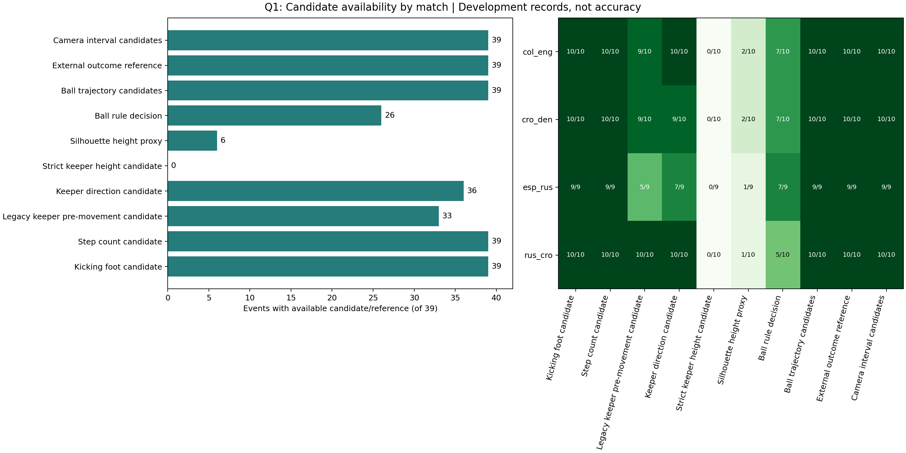
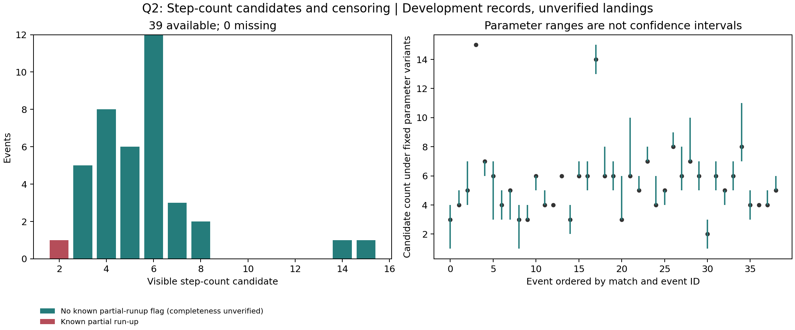
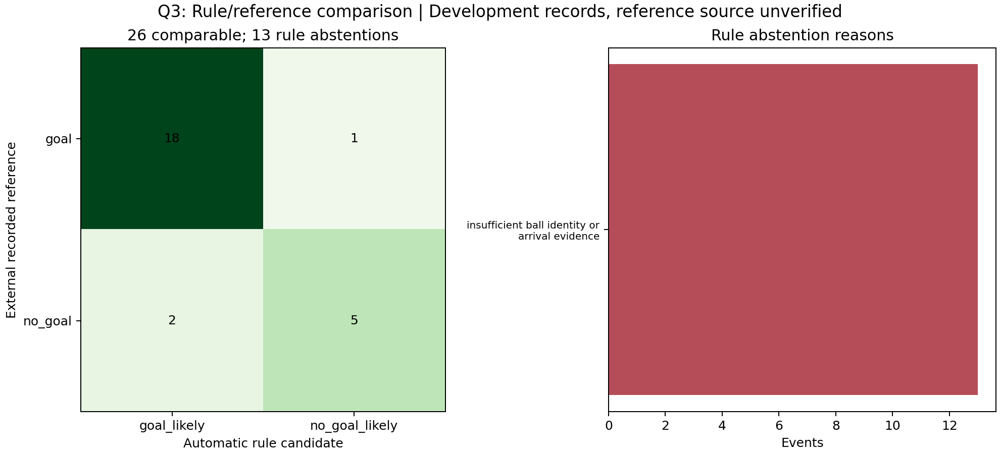

# IND5003 Vision II: 39 次点球分析

这是在小组原项目上完善的私有开发仓库，保留原提交和来源记录。主入口现在提供统一的 39 段结果、可复现 EDA、验证状态与逐段复核模板。当前结果仍是开发候选，不能承诺满分或独立识别准确率。

原项目：[RX422040/vision-ii-penalty-analysis](https://github.com/RX422040/vision-ii-penalty-analysis)，基于提交 `f3eb946a1595c084af33edfbc2452b016736bc30`。模型、历史实验、缓存和早期算法来自原小组项目；本轮新增结果整合、EDA 防护、运行迁移、稳定器与球终点修复。仓库保留提交历史，不把原作者的工作重新标成个人独立完成。

## 先看这些文件

| 内容 | 入口 |
|---|---|
| 正式 39 条统一特征与状态 | [features_39.csv](outputs/final_analysis/features_39.csv) |
| 开发集指标、弃权与冲突 | [evaluation.json](outputs/final_analysis/evaluation.json) |
| 输入哈希和原始视频验证边界 | [provenance.json](outputs/final_analysis/provenance.json) |
| EDA 图和独立重算摘要 | [EDA 目录](outputs/final_analysis/eda/) |
| 可执行分析 Notebook | [final_analysis.ipynb](notebooks/final_analysis.ipynb) |
| 英文方法与研究问题 | [FINAL_ANALYSIS_METHODS.md](docs/FINAL_ANALYSIS_METHODS.md) |
| 英文报告审阅稿 | [REPORT_REVIEW_DRAFT.md](docs/REPORT_REVIEW_DRAFT.md) |
| 提交前需要补齐的证据 | [SUBMISSION_READINESS.md](docs/SUBMISSION_READINESS.md) |
| 真人复核空白表 | [human_review_template.csv](outputs/final_analysis/human_review_template.csv) |
| 课程要求原文 | [课程 PDF](docs/ind5003_vision_ii_project_requirements.pdf) |

## 本轮修复

相机运动补偿在估计失败或视频解码缺口后立即断链，避免遗漏的相机位移被解释成门将移动。只保留有完整参考链的轨迹；受影响的观察窗口返回未知或空值。修复后尚未重算旧门将测量，统一表明确标记旧赛前移动结果需要重新运行。

足球的最后观察点与事件结束位置现在分别保存。没有已验证事件结束时间和对应观测，就不会给出事件终点；空轨迹不会再产生 `(0, 0)` 或速度零这样的假测量。

正式 EDA 只接受 39 条、唯一 ID、哈希一致的结果包。旧 `data/processed/penalties_features.csv` 和历史 Notebook 保留为归档，不是本轮实证分析入口。旧合成流程 `src.pipeline` 默认禁用，只有显式 `--demo` 才能运行，并在每条记录中标注 `synthetic_demo`。

最新门将方向、严格阶段高度、轮廓代理、左右脚开发候选、用户参考和自动球规则分别保存。现有赛果表和 AI 画面判断不会用于填补自动规则输出。可配置输入文件，后续新实验可以重新汇总。

主运行入口支持 `--device auto/cpu/mps/cuda:0` 和 `--ffmpeg`，记录模型及来源哈希。显式要求不可用 CUDA 会报错，不会悄悄改成 CPU。

## 当前实际结果

正式事件数是 39，来自四场点球大战：`col_eng` 10、`cro_den` 10、`esp_rus` 9、`rus_cro` 10。切片和回放不增加独立样本数。

| 项目 | 目前可报告的事实 |
|---|---|
| 球的自动规则 | 20 次 `goal_likely`、6 次 `no_goal_likely`、13 次 `unknown` |
| 与已有赛果参考对照 | 覆盖 26/39；其中一致 23/26；事件 22、25、30 冲突 |
| 门将方向 | 36 个图像坐标候选、3 个未知；不是门将自身左右或真人准确率 |
| 门将高度 | 严格阶段候选 0；轮廓代理 6；旧高度候选单独留存 |
| 步数 | 39 个候选，0 个独立已验证总步数；Brozovic 一段已知助跑不完整 |
| 左右触球脚 | 标称候选 39，但参数稳定候选仅 1；10 段已有用户参考属于方法开发样本 |
| 地面俯视校准 | 0/39 已验证，不能把图像轨迹写成真实俯视轨迹或米制距离 |
| 球的事件最终位置 | 0/39 已验证；末次观察单独记录 |
| 正式机位区间 | 已恢复 197 个候选区间，覆盖 39 段；187 个课程类别未知，慢动作状态全部未知，人工核验数 0 |

赛果参考文件声称来源为 FIFA 技术报告，本轮没有逐项重新核对该 PDF。23/26 是开发数据上的参考一致率，需同时报告 26/39 覆盖率，不能写成总体准确率。10 段左右脚参考也不能外推成 39 段全部正确。三张图是本轮实际生成的：







## 无 GPU 的可复现分析

本轮在 macOS / Python 3.13.15 上创建独立环境并验证此路线。它只使用仓库内的结构化实验记录，不需要下载模型、3.58 GB 补包或原始视频。

```sh
python3 -m venv .venv-analysis
source .venv-analysis/bin/activate
python -m pip install -r requirements-analysis.txt
python -m scripts.build_final_results --output-dir outputs/my_final
python -m src.eda_analysis --features-csv outputs/my_final/features_39.csv --output-dir outputs/my_final/eda
python -m pytest -q tests/test_final_results.py tests/test_final_eda.py
python -m scripts.verify_final_bundle --require-eda
```

Windows 激活命令为 `.venv-analysis\Scripts\Activate.ps1`。每次选择新输出目录；构建器拒绝覆盖非空目录。仓库中保存的 `outputs/final_analysis/` 是本轮冻结结果。修改候选或输入后需要同时重新生成表、指标、哈希和图。

`configs/final_analysis.yaml` 指定各模块输入版本。若拥有原作者的同字节 rawclip，可以加入 `--raw-clips-dir data/raw_clips` 逐段校验原始视频 SHA-256；重新编码的视频不能复用旧来源验证。

也可以使用主入口：

```sh
python run_project.py final-results --output-dir outputs/my_bundle
python run_project.py eda --features-csv outputs/my_bundle/features_39.csv --output-dir outputs/my_eda
```

## 模型推理和实验室 4090

本轮没有完成新的真实视频模型推理，也没有训练模型。实验室 `lab4090` 的一次只读 SSH 检查超时；当前本机也缺少 Ultralytics 和可用 FFmpeg，所以 GPU 运行能力仍需在实验室实测。

先安装与实验室驱动兼容的 CUDA PyTorch、Ultralytics 和系统 FFmpeg，再恢复补包、放入来源匹配的 rawclip。原 `requirements-pycharm.txt` 是 Windows CPU 环境快照，不能直接当作已经验证的 Linux CUDA 配置。

以下命令已接通设备和路径参数；需要具备对应上游证据后才能运行：

```sh
python run_project.py check --device cuda:0 --ffmpeg /usr/bin/ffmpeg
python run_project.py refresh-ball --device cuda:0 --ffmpeg /usr/bin/ffmpeg --output-dir outputs/ball_cuda_run
python run_project.py steps --device cuda:0 --output-dir outputs/steps_cuda_run
python run_project.py camera --device cuda:0 --output-dir outputs/camera_cuda_run
python run_project.py goalkeeper --device cuda:0 --ffmpeg /usr/bin/ffmpeg --output-dir outputs/keeper_cuda_run
```

`refresh-ball` 只更新门前短窗口足球检测，仍使用已有球门、镜头、种子和轨迹输入。`goalkeeper` 是首次扑救阶段与高度实验，也依赖已有角色和方向结果。它们不代表从零重算所有历史实验。原基础门将稳定器的重算入口是 `python -m scripts.run_goalkeeper_analysis --help`，须提供真实视频、跟踪和触球证据。

4090 优先用于重算修复后的运动补偿、比较更大姿态模型、球身份与首次扑救窗口。提分更关键的是完整事件范围、正确坐标定义、独立复核、失败分析和报告证据，增加 GPU 算力不会自动解决这些问题。

## 可选原项目补包

本仓库不复制缺失的 LFS 大对象。原提交历史保留，但当前检出无需 Git LFS。正式机位 CSV/JSON 已通过 HTTP Range 从固定 Release 取回，哈希与原清单一致，见 [获取记录](docs/camera_asset_recovery.json)。模型及其余历史资产仍需补包，原视频不在补包里。

```sh
python -m scripts.fetch_support_assets
python -m scripts.fetch_support_assets --download
python restore_project_files.py
```

第一条只列出大小与哈希；第二条下载约 3.58 GB 并核对 SHA-256；恢复约 4.69 GB 内容，建议额外预留至少 10 GB。Release 固定为 [v2026.10.11-assets](https://github.com/RX422040/vision-ii-penalty-analysis/releases/tag/v2026.10.11-assets)。还原器拒绝覆盖不同内容的现有文件。rawclip 需另外取得并放入 `data/raw_clips/`。

原项目的实验报告和历史 Notebook 可用于追溯方法，部分需要此补包或原 Windows 路径迁移。当前正式 EDA 使用本 README 指定的新入口。

## 学术与交付边界

保存候选、测试通过、代码能执行、赛果一致和真人视觉验证是不同证据。复核模板当前为空，不是已完成的人工标注；人工补写最终字段不能冒充自动特征提取成功。学生需要理解并验证最终代码、报告和视频，按课程要求说明原小组工作、外部库、文献及 AI 辅助。

本仓库是开发与审阅材料，尚未提交课程作业。英文报告提供 [PDF 审阅稿](docs/REPORT_REVIEW_DRAFT.pdf) 和 [Word 审阅稿](docs/REPORT_REVIEW_DRAFT.docx)，仍需小组核查测量、贡献与最终内容，并制作真人配音视频。排版脚本为 `scripts/render_report_draft.py`，可选依赖见 `requirements-report.txt`。
