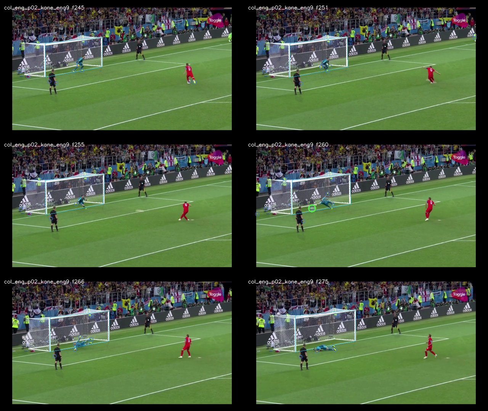

# IND5003 Vision II：点球视频分析

这个项目分析了 2018 年世界杯四场点球大战中的 39 次罚球：哥伦比亚对英格兰、克罗地亚对丹麦、西班牙对俄罗斯，以及俄罗斯对克罗地亚。主要关注助跑步数、触球脚、守门员的移动和扑救、球的轨迹与赛果，也记录转播镜头的变化。

代码在小组原项目的基础上继续修改，并用实验室的 RTX 4090 重新跑了全部 39 段视频。

## 查看结果

| 文件 | 内容 |
|---|---|
| [报告 PDF](outputs/fresh_course_experiment/report_v1/REPORT_FRESH_REVIEW_DRAFT.pdf) / [Word](outputs/fresh_course_experiment/report_v1/REPORT_FRESH_REVIEW_DRAFT.docx) | 方法、分析和遇到的问题，目前为审阅稿 |
| [结果表](outputs/fresh_course_experiment/final_bundle_v1/features_39.csv) | 每次罚球一行，共 39 行 |
| [完整 JSON](outputs/fresh_course_experiment/final_bundle_v1/features_39.json) | 各模块的输出、帧号及来源记录 |
| [逐段查看](outputs/fresh_course_experiment/review_v1/index.html) | 下载仓库后在浏览器打开，查看检测图片和对应结果 |
| [统计图](outputs/fresh_course_experiment/final_eda_v1/) | 特征覆盖、步数比较和赛果分析 |

下面是 Kane 罚球片段的检测输出，图中保留了视频帧号，方便回看原画面。



## 方法和当前结果

先按罚球切片，再用 YOLO11m-pose 提取人物姿态，用 YOLO11n 和 YOLO11m 检测足球。触球时间通过球从静止到离开罚球点的观测确定，后续的步数和门将移动都围绕这个时间计算。球被挡住、人物身份有冲突或镜头切换时，脚本保留 `unknown`。

目前各项输出的覆盖情况如下。这里的次数表示脚本给出了候选结果，仍需逐段复核。

| 项目 | 有输出的罚球次数 |
|---|---:|
| 触球时间 | 33 / 39 |
| 助跑步数 | 32 / 39 |
| 左右触球脚 | 8 / 39 |
| 门将触球前移动 | 29 / 39 |
| 门将扑救方向 | 23 / 39 |
| 球的可见轨迹 | 33 / 39 |
| 助跑中的地面投影点 | 32 / 39 |
| 课程指定机位类别 | 11 / 39 |
| 转播比分板的进球／未进球结果 | 35 / 39 |

比分板分析读取原视频里的红绿罚球图标；这 35 次输出与 FIFA 技术报告中的赛果记录一致，另有 4 次没有足够画面。它与球轨迹判断分开保存。因为这批视频已经用于调试，35/35 只说明当前样本上的一致性，不作为独立测试准确率。

有几项还没做好：左右脚识别容易受到姿态模型的左右关节混淆影响；地面投影目前是稀疏点，还不是完整的俯视助跑轨迹；扑救高度只有 6 段图像平面信号，不能换算成真实高度。慢动作状态和球的最终停留位置目前都保留为未知。门将方向统一按画面左、右记录，步数只统计视频中可见的助跑部分。

## 在本机运行

查看报告、结果表和检测图片不需要 GPU。重新生成统计图可以直接使用仓库里的结果文件：

```sh
git clone https://github.com/Gabric-cau/ind5003-vision-ii.git
cd ind5003-vision-ii
python3 -m venv .venv-analysis
source .venv-analysis/bin/activate
python -m pip install -r requirements-analysis.txt
python -m src.fresh_eda \
  --bundle-dir outputs/fresh_course_experiment/final_bundle_v1 \
  --output-dir outputs/my_eda
```

Windows 的虚拟环境激活命令为 `.venv-analysis\Scripts\Activate.ps1`。输出目录需要为空。

如果要运行测试，再安装 OpenCV 和 SciPy：

```sh
python -m pip install -r requirements-experiments.txt
python -m pytest -q
```

从原视频重新提取特征需要另外准备视频、模型权重和 FFmpeg。CUDA 环境记录在 [requirements-cuda.txt](requirements-cuda.txt)，各阶段的脚本位于 `scripts/run_fresh_*`；运行参数可通过 `--help` 查看。具体的特征定义和实验设置见 [实验说明](docs/FRESH_EXPERIMENT_PROTOCOL.md)。

## 文件组织与来源

`src/` 放分析模块，`scripts/` 放运行脚本，`configs/` 放切片和分析配置，`tests/` 放测试。当前结果统一放在 `outputs/fresh_course_experiment/` 下，其他实验目录保留用于比较早期版本。

原小组仓库：[RX422040/vision-ii-penalty-analysis](https://github.com/RX422040/vision-ii-penalty-analysis)。这里保留了原提交历史，后续修改主要涉及触球时间、足球跟踪、相机运动补偿、地面标定、比分板分析和结果整理。代码与文档更新使用了 AI 辅助。
