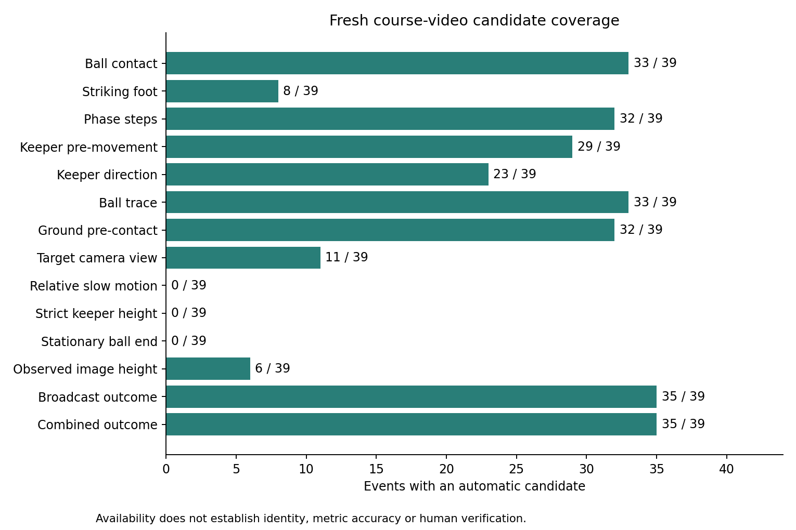
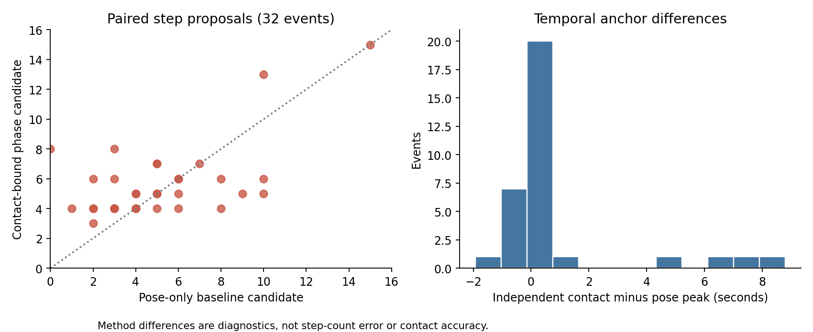
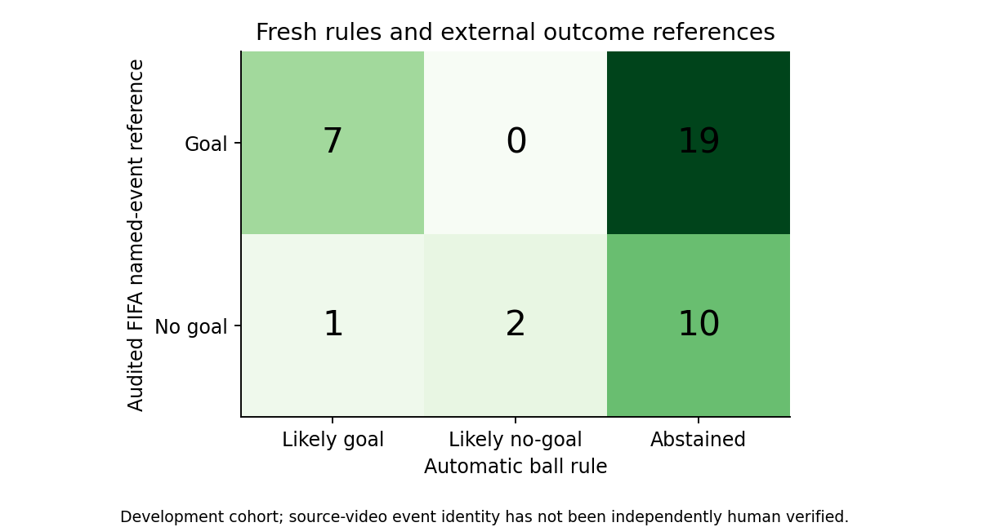

# Vision II: Evidence-Aware Penalty Analysis in Broadcast Football Video

Review draft for group verification, 12 October 2026. This document has not been submitted. It reports the source-bound development experiment in `outputs/fresh_course_experiment/final_bundle_v1/`; it does not claim a held-out accuracy, completed human annotation, authorship allocation, or a final course grade. The group must verify the wording, references, contribution statements, figures, and video narration before submission.

## 1. Literature Review

Penalty analysis is an observational measurement problem before it is a classification problem. The OSPAF study, Design and Validation of an Observational System for Penalty Kick Analysis in Football, motivates explicit event definitions, viewing-angle checks and observer agreement, but it does not validate this project's automatic rules. The study is therefore used to justify a measurement protocol, not to claim that a detected foot, step or dive is correct.

Broadcast soccer combines person detection, role association, camera geometry, identity tracking and editing. The SoccerNet Game State Reconstruction tasks similarly treat field localization, player roles and identities as connected quantities. This project adopts that decomposition: a pose track is retained only as a candidate until the actor, source pixels and action interval pass independent guards. The SoccerNet material is conceptual context rather than an imported benchmark or an achieved benchmark score.

The project also uses planar homography for a restricted ground-plane diagnostic. OpenCV's homography documentation explains the transformation between planes; it does not turn an airborne ball, hip point or image polyline into a metric trajectory. The analysis therefore reports source-image coordinates, sparse sole candidates, held-out line checks and calibration status separately. A same-frame ground candidate is not a continuous top-down run-up measurement.

The new methodological component is a source-only, staged evidence design. YOLO11 pose and object detectors supply candidate observations, a frozen contact rule binds a stationary ball identity to causal departure, SAM2 supplies a guarded goalkeeper-mask pilot, and image processing reads broadcast penalty icons without OCR or external outcome labels. The independent reference audit is joined after prediction. This ordering supports skepticism about impressive-looking agreement and makes abstention a reportable result.

## 2. Data Collection and Preparation

The unit is one penalty event. The canonical cohort contains 39 attempts: ten from Colombia-England, ten from Croatia-Denmark, nine from Spain-Russia and ten from Russia-Croatia. The four original recordings were hashed before clipping. Each context clip stores its original source frame interval, source-video hash, 1280 by 720 dimensions and 30 FPS clock. Context boundaries are not treated as verified semantic walk-to-spot or play-end boundaries.

The 4090 rerun uses an isolated Linux environment with Python 3.11, PyTorch 2.7.0 plus CUDA 12.8 and Ultralytics 8.4.175. Official YOLO11n, YOLO11m, YOLO11m-pose and SAM2-t bytes are recorded with sizes and SHA256 values. YOLO11n and YOLO11m object inference use the identical 39-event source cohort, pose input, image size, thresholds and temporal rules. Model selection is based on source evidence coverage and disagreement diagnostics, never on a reference outcome.

The contact selector is pre-registered. If both detectors support a contact, their actor IDs and timing brackets must agree and at least three shared stationary source frames must occupy the same spot. Compatible alternatives are ranked by contact score, bracket width and actual departure confidence. A single supported producer is retained; a conflict abstains. The selector copies existing neural artifacts and performs no new neural inference. Original nano and medium directories remain frozen.

The final evidence bundle binds pose, selected ball/goal-guard result, revised foot, contact-bound phase, joint pitch diagnostic, camera-v2 result, endpoint, goalkeeper height and scoreboard components to one source manifest. Each component records code, model, source and producer hashes. Missing numeric values remain null. `human_verified`, `accuracy_validated`, physical height and event-final position are explicit flags rather than inferred defaults.

## 3. Exploratory Data Analysis

Figure 1 reports availability in the fresh 39-event bundle. Independent contact candidates exist for 33 events. Contact-bound phase candidates exist for 32 events, with 29 source-bound keeper movement candidates and 23 image-direction candidates. The camera stage has 11 target spatial-view candidates and zero automatic slow-motion decisions. These counts describe observable candidates and complete source chains, not feature accuracy.

The joint calibration stage supports 493 of 582 same-frame paired samples and 307 sparse sole projections in the medium phase comparison. These are geometric support counts, not a continuous top-down trajectory or metric distance. Fourteen events have no pre-contact ground candidate under the strict source checks. A diagnostic overlay is retained for review; the original pixels and held-out line checks are hash-bound.

Figure 2 shows the relationship between baseline pose candidates and contact-bound phase candidates, together with the difference between the pose peak and the independent contact bracket. The method deliberately preserves unknowns when stationary departure, actor identity or camera support is absent.

The revised foot module reports eight motion candidates, five right and three left, while 31 events remain unknown. The two added candidates arise from a pre-registered separation of stationary-ball evidence from post-departure motion, not from lowering the vote threshold. The stationary nearest-foot value remains diagnostic and cannot by itself choose the anatomical striking foot. The observed goalkeeper image-plane signal has six conditional low candidates and 33 unknowns; all strict complete-dive ordinal candidates and all physical-metre estimates remain unknown because the visible body reference or first dive is incomplete.

Figure 3 compares the frozen ball rule, a source-only broadcast-scoreboard rule and their conflict-abstaining combination with the audited named-event reference. The ball geometry rule decides ten events after its keeper-occlusion guard. The scoreboard parser supplies 35 icon candidates and abstains on four final attempts. The combined source rule decides 35 events because the scoreboard and ball evidence agree where both are available or the scoreboard is the only bounded source witness.

The scoreboard result is an ordinal broadcast-icon candidate, not proof that the tracked ball crossed the goal plane or that the event ended at the last visible observation. Against the audited external named-event references, the 35 decided scoreboard candidates agree 35 out of 35. This is development agreement on a cohort inspected during method development, not held-out accuracy or independent human video ground truth.

## 4. Research Questions and Findings

The first question asks how much of each requested feature is observable from the four broadcast shootouts. The answer is heterogeneous. Source-bound contact exists for 33 of 39 events, yet strict endpoint verification is zero and camera playback classification is zero. The missingness is informative: replays lose lower-body or role continuity, goal-line occlusion hides the ball, and a context clip can end before play ends. Treating every missing output as a negative football behavior would be a measurement error.

The second question asks whether independent contact timing changes run-up and step candidates. The phase module produces 32 contact-bound step candidates; its sensitive, central and strict windows are retained for each event. The median range and event-level differences are descriptive sensitivity evidence. They do not establish true landing precision or a step-count error because no untouched landing annotations exist and one broadcast approach is explicitly incomplete. The appropriate conclusion is that contact and phase definitions materially affect candidate counts and should be shown in the report.

The third question asks whether source-only outcome evidence can reduce outcome abstention. A ball trajectory rule remains conservative after the keeper-body occlusion guard: it decides ten events. The independent scoreboard parser identifies stable, repeated red or green penalty icons for 35 events in original full-video frames and uses neither numbers nor FIFA labels. Combining these evidence sources decides 35 events, with four unresolved final attempts. This is a useful engineering result about observability, while the remaining endpoint and human-identity limits prevent a claim of scoring accuracy.

The outcome references come from a separately audited FIFA technical-report extraction, joined after all predictions. They are not used to select the model, actor, contact frame, scoreboard icon or trajectory. The cohort is not held out: source identity, references and diagnostic frames have been inspected during development. A future evaluation should reserve new uninspected attempts and review their actor, contact, endpoint and outcome definitions before any threshold choice.

## 5. New Techniques, Iteration, and Limitations

The first iteration used pose peaks, nearest-ankle proximity and legacy event boundaries. The fresh iteration exposed their failure modes. A pose peak is not necessarily a foot-ball contact, the nearest ankle can be the planted support foot, and a stationary last observation is not a final event position. The repaired analysis therefore requires a source-bound stationary-to-departure bracket, preserves the detector identity, and abstains when the actor or departure evidence fails.

The medium detector was tested as a controlled ablation against the nano detector. Nano supports 26 contacts and medium supports 29, with 22 events supported by both, seven medium-only events, four nano-only events and six shared abstentions. Their outcome branches differ substantially, including a Muriel source-frame disagreement; the selection protocol does not resolve that disagreement with the external score. This comparison is evidence about model sensitivity, not proof that the larger model is universally better.

The joint pitch calibration fits small-area and goal-line geometry and checks held-out penalty-area sides and goal-width corners. It improves geometric support counts while retaining cases with ambiguous line families. The goalkeeper height work adds a SAM2 temporal mask pilot. It rejects a mask when the body is truncated, a ball is absorbed, or identity continuity fails. The resulting observed image-plane signal is labelled conditional and censored; no physical height is invented.

The scoreboard method searches the original full recording from each event's slice end to the next canonical slice start, or to source end for the final attempt. It detects repeated five-circle icon geometry and state transitions, requires a stable ordinal-compatible panel and stores source-frame pixel hashes. It does not read the displayed numeric score. This is a new source-image witness and remains separate from tracked-ball crossing and event-final position.

The camera-v2 repair reuses high-resolution source-bound live tracks from the 4090 pose result when the actor, shot and contact identity match, while cross-shot queries still require their own fresh analysis. This raises the live reference continuity from 13 to 33 kicker clips and from 2 to 28 keeper clips under the fixed ten-sample guard. It changes view candidates modestly, from two to three back-of-kicker and two to eight 45-degree-right candidates, while playback remains unknown for all 320 intervals. The repair addresses a documented input bottleneck; it does not claim slow-motion classification.

The main limitations are observable in the bundle. No human reviewer has independently verified all 39 actor identities, foot labels, landing events, camera classes or outcome endpoints. The source clip is a context interval, not a guaranteed semantic play-end boundary. Image-left and image-right are source-image conventions. Sparse ground points are not a continuous bird's-eye path. A scoreboard icon is not a goal-plane crossing. The automatic agreement numbers are development diagnostics. These limits define the next review work rather than being hidden by a complete-looking table.

## 6. Code Structure and Reproducibility

Reusable components live in `src/`. Experiment entry points live in `scripts/`, and tests cover source binding, stale producer rejection, coordinate contracts, camera chains, model ablation, endpoint censoring, mask identity, scoreboard parsing and outcome conflict abstention. The full local suite passes 788 tests and 35 subtests. Passing tests establish implementation contracts, not video accuracy.

The 39-event bundle is built with `scripts/build_fresh_results.py`, verified and graphed with `src/fresh_eda.py`, and reviewed with the offline `scripts/build_fresh_review.py` viewer. The viewer lets a reviewer select an event, play its hashed context clip, inspect source-image detector evidence, inspect sparse ground projections and read the component record. The bundle manifest and review manifest record every copied artifact hash. Raw videos remain outside the Git working tree and are stored only in the private release because they are course material.

The CUDA stack is separate from the Python 3.13 CPU EDA stack. The exact Linux environment is listed in `requirements-cuda.txt`; `docs/LAB_RUNTIME_2026-10-12.json` records the 4090, CUDA runtime, packages, official model receipts and source inputs. No shared lab environment was modified. A teaching-team reproduction package should include ordinary source files, documented model retrieval and permitted course data rather than requiring a private GitHub login or a student's lab account.

The report and demonstration must be reviewed by the students. The final video should use a real source clip, show the source-to-frame clock, actor/contact evidence, one candidate row and one abstention, and use a student's natural human narration without speed-up or AI voice. The group must check every line of code and every statement, describe AI assistance and genuine contributions, and complete the official submission and peer-evaluation process separately from this development repository.
