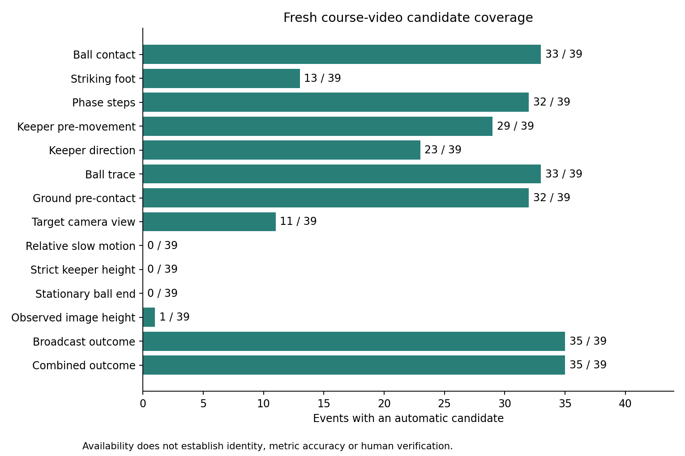
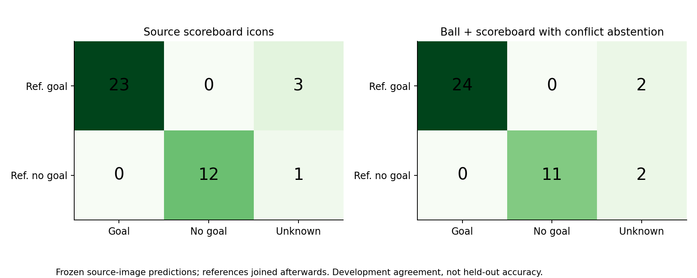

# Vision II: Evidence-Aware Penalty Analysis in Broadcast Football Video

Review draft for group verification, updated 22 October 2026. This document has not been submitted. It reports the frozen 39-event bundle in `outputs/fresh_course_experiment/final_bundle_v3_shoe_fusion/`, the original-recording continuous-shoe experiment in `shoe_approach_analysis_v2/`, the rule-support replay in `shoe_landing_replay_2026-10-18_v1/`, and separate earlier pilots. This revision integrates the supplied v040 human reference and reports its single-reviewer diagnostic comparisons. It performs no new neural inference. The group must verify the wording, references, contribution statements, figures, and video narration before submission.

## 1. Literature Review

Penalty analysis is an observational measurement problem before it is a classification problem. Pinheiro et al. (2021), [Design and Validation of an Observational System for Penalty Kick Analysis in Football (OSPAF)](https://doi.org/10.3389/fpsyg.2021.661179), motivates explicit event definitions, viewing-angle checks and observer agreement, but it does not validate this project's automatic rules. The study is therefore used to justify a measurement protocol, not to claim that a detected foot, step or dive is correct.

Broadcast soccer combines person detection, role association, camera geometry, identity tracking and editing. The [SoccerNet Game State Reconstruction task](https://www.soccer-net.org/tasks/game-state-reconstruction) similarly treats field localization, player roles and identities as connected quantities. This project adopts that decomposition: a pose track is retained only as a candidate until the actor, source pixels and action interval pass independent guards. The SoccerNet material is conceptual context rather than an imported benchmark or an achieved benchmark score.

The project also uses planar homography for a restricted ground-plane diagnostic. [OpenCV's homography documentation](https://docs.opencv.org/4.x/d9/dab/tutorial_homography.html) explains the transformation between planes; it does not turn an airborne ball, hip point or image polyline into a metric trajectory. The analysis therefore reports source-image coordinates, sparse sole candidates, held-out line checks and calibration status separately. A same-frame ground candidate is not a continuous top-down run-up measurement.

The [MediaPipe Pose Landmarker](https://developers.google.com/edge/mediapipe/solutions/vision/pose_landmarker/index) provides 33 image landmarks, including heel and foot index, beyond the ankle locations available in the original 17-point pose. This motivates a paired shoe-landmark experiment. The predicted points remain model evidence: neither a high visibility score nor a foot segment near a ball proves physical contact. Model world-coordinate outputs are not used to infer metric height.

The new methodological component is a source-only, staged evidence design. YOLO11 pose and object detectors supply candidate observations, a frozen contact rule binds a stationary ball identity to causal departure, SAM2 supplies a guarded goalkeeper-mask pilot, and image processing reads broadcast penalty icons without OCR or external outcome labels. The independent reference audit is joined after prediction. This ordering supports skepticism about impressive-looking agreement and makes abstention a reportable result.

## 2. Data Collection and Preparation

The unit is one penalty event. The canonical cohort contains 39 attempts: ten from Colombia-England, ten from Croatia-Denmark, nine from Spain-Russia and ten from Russia-Croatia. The four original recordings were hashed before clipping. Each context clip stores its original source frame interval, source-video hash, 1280 by 720 dimensions and 30 FPS clock. Context boundaries are not treated as verified semantic walk-to-spot or play-end boundaries.

The rerun uses an isolated Linux environment with Python 3.11, PyTorch 2.7.0 plus CUDA 12.8 and Ultralytics 8.4.175. Official YOLO11n, YOLO11m, YOLO11m-pose and SAM2-t bytes are recorded with sizes and SHA256 values. YOLO11n and YOLO11m object inference use the identical 39-event source cohort, pose input, image size, thresholds and temporal rules. Model selection is based on source evidence coverage and disagreement diagnostics, never on a reference outcome.

The contact selector is pre-registered. If both detectors support a contact, their actor IDs and timing brackets must agree and at least three shared stationary source frames must occupy the same spot. Compatible alternatives are ranked by contact score, bracket width and actual departure confidence. A single supported producer is retained; a conflict abstains. The selector copies existing neural artifacts and performs no new neural inference. Original nano and medium directories remain frozen.

The final evidence bundle binds pose, selected ball/goal-guard result, revised foot, contact-bound phase, joint pitch diagnostic, camera-v2 result, endpoint, goalkeeper height and scoreboard components to one source manifest. Each component records code, model, source and producer hashes. Missing numeric values remain null. `human_verified`, `accuracy_validated`, physical height and event-final position are explicit flags rather than inferred defaults.

Additional data collection follows the course brief's invitation to seek relevant evidence. A public FIFA edition of Colombia-England was downloaded at 1920 by 1080 with a 50 FPS container clock. Sequential decoding yielded 25,607 frames without adjacent exact repetitions; this does not establish native camera capture rate or playback speed. Three coarse main-view intervals were cut for Falcao, Kane and Cuadrado without resizing, using lossy CRF10 encoding. Their source hashes, frame mappings and endpoint comparisons are recorded separately. This alternate edit is neither three new independent attempts nor a replacement for the four specified course recordings.

The v040 annotation package, supplied separately from the repository and integrated on 22 October, attributes 39 event reviews to Ruizhe Xu. The retained source records contain human-reported striking feet, 223 landing observations inside the frozen windows and five outside-window observations. They also contain 156 qualitative shot/save cells: shot height, save height, ball horizontal direction and save direction for every event. The integration verifies all 47 listed source-artifact hashes, preserves the original bytes and matches all 39 video hashes and the prediction-freeze hash. This establishes artifact correspondence; the script does not independently authenticate the reviewer's identity or viewing history.

Annotation provenance differs by field. Landing frames and anatomical sides were supplied by the human and transcribed by an assistant. Full-approach visibility for most events was assessed with AI assistance and is not a second human review. The reviewer had seen aggregate candidate counts, so the review is not fully blinded. The shot/save categories use source-image left/right and qualitative low/middle/high; exact evidence frames and metric heights were not supplied. Two explicitly wide shots, Aspas and Fernandes, have reviewed-unknown shot height and ball direction under the user's stated policy. Those four unknown cells are completed annotations, not missing work. The original category values and raw messages remain in the imported provenance.

## 3. Exploratory Data Analysis

Figure 1 reports availability in the fresh 39-event bundle. Independent contact candidates exist for 33 events. Contact-bound phase candidates exist for 32 events, with 29 source-bound keeper movement candidates and 23 image-direction candidates. The camera stage has 11 target spatial-view candidates and zero automatic slow-motion decisions. These counts describe observable candidates and complete source chains, not feature accuracy.

The selected final joint-calibration output supports 521 of 609 sampled source frames, with 339 sparse sole candidates and 226 pre-contact ground candidates across 32 events. Seven events have no pre-contact ground candidate under the source checks. These are geometric support counts, not a continuous top-down trajectory or metric distance. A diagnostic overlay is retained for review; the original pixels and held-out line checks are hash-bound.

Figure 2 shows the relationship between baseline pose candidates and contact-bound phase candidates, together with the difference between the pose peak and the independent contact bracket. The method deliberately preserves unknowns when stationary departure, actor identity or camera support is absent.

The selected foot module reports thirteen candidates, nine right and four left, while 26 events remain unknown. Eight come from the earlier ankle-based V2 rule. Five previously unknown events gain a fallback from the new paired shoe-swing and shoe-region checks: Rashford, Dier, Spain-Russia Smolov and Vida are right candidates, while Pivaric is left. Both producers and the selection reason are retained. The stationary nearest-foot value remains diagnostic and cannot by itself choose the anatomical striking foot. This is increased development availability, not measured anatomical accuracy.

A reference-validity repair withdraws five former low-height categories whose fixed-depth reference had failed. One conditional low image-plane signal remains for Brozovic, with 38 unknowns. The underlying measured values are retained, while all strict complete-dive ordinal candidates and physical-metre estimates remain unknown.

The continuous-shoe experiment revisits the same original recordings. Thirty-two attempts have supported approach intervals; fresh normal/mirror inference processes 2,121 source frames through 4,242 model calls. The original 13 October analysis found twelve stance-transition proposals in seven events. Replaying those exact pose observations on 18 October with complete stance-support collection retains all twelve proposals and yields ten additional proposals, for twenty-two in twelve events. Fifteen processed windows have no accepted proposal, five abstain on temporal anatomical-channel ambiguity, and seven lack eligible inputs. Figure 3 compares the original and repaired candidate counts. Rashford has fifteen ankle extrema, three original shoe proposals and six repaired shoe proposals; Pivaric retains three shoe proposals. The increase establishes repaired rule coverage, not improved step accuracy. The newly integrated single-human comparison below exposes substantial missed landings. A detected zero is not evidence that the player took zero steps.

Figure 4 compares the frozen ball rule with the audited named-event reference, while Figure 5 shows the source-only broadcast-scoreboard rule and the conflict-abstaining combination. The ball geometry rule decides ten events after its keeper-occlusion guard. The scoreboard parser supplies 35 icon candidates and abstains on four final attempts. The combined source rule also decides 35 events, but these are not the same 35 events: Koke's conflicting ball and scoreboard predictions cause abstention, while the ball rule supplies Croatia-Denmark Rakitic's outcome without a scoreboard candidate. The other three unknown combined outcomes are Dier, Aspas and Russia-Croatia Rakitic.

The scoreboard result is an ordinal broadcast-icon candidate, not proof that the tracked ball crossed the goal plane or that the event ended at the last visible observation. Against the audited external named-event references, the 35 decided scoreboard candidates agree 35 out of 35. This is development agreement on a cohort inspected during method development, not held-out accuracy or independent human video ground truth.

The new human categorical labels expose errors that candidate coverage alone cannot show. The foot supplement decides 14 of 39 events and agrees with the supplied striking-foot label in 12 of those 14, or 85.7% conditional agreement at 35.9% coverage. Golovin and Brozovic disagree: the automatic candidate is left and the supplied human label is right. These cases are retained as disagreements; the automatic feature table is not overwritten. Keeper image-direction candidates agree in 19 of 23 decided events, or 82.6% at 59.0% coverage. Bacca, Krohn-Dehli, Jorgensen and Croatia-Denmark Rakitic disagree. The categories are first mapped explicitly from image_left/image_right to source-image left/right. Figure 6 retains unknown predictions so that conditional agreement cannot hide low coverage.

There are 27 windows with numeric landing predictions; twelve have unknown predictions and are excluded rather than assigned zero. Within the comparable windows, the human lists contain 156 landings and the rule produces 22. Ordered one-to-one matching within 0.08 seconds gives 13 matches, nine unmatched predictions and 143 unmatched listed landings. Precision against the supplied lists is 59.1%, recall is 8.3%, and the mean absolute difference in visible list count is 4.963 per comparable window. These are single-reviewer list diagnostics, not independently established true-step accuracy: list completeness was not separately human-confirmed for every clip, the full approach may be truncated and the dataset informed development. Figure 7 makes the undercount visible instead of presenting the implementation repair as solved step extraction.

An additional 22 October development experiment addresses a specific modelling restriction: the whole-shoe rule requires heel and toe to be simultaneously stationary, although a foot can rotate around a planted heel or forefoot. The supplement accepts a fixed heel or a fixed toe as the support point, requiring that exact anatomical landmark to form a complete supported stance in both normal and mirrored predictions. It never switches landmarks within a stance. All confidence, body geometry, camera, timing and separation thresholds remain unchanged. Original candidates have priority; an added same-foot candidate within the existing 0.15-second separation is merged to avoid counting the same stance twice. The prediction function reads saved poses only, while the design motivation and subsequent comparison use this development cohort's observed failure. This is not a held-out method selection.

On the same 27 comparable windows, the supplement retains all 22 original candidates and adds 43, for 65 candidates. Matched human-list events rise from 13 to 41; unmatched predictions rise from nine to 24 and unmatched listed events fall from 143 to 115. Single-reviewer list precision changes from 59.1% to 63.1%, recall from 8.3% to 26.3%, and count MAE from 4.963 to 3.370. Seven missing input windows and five anatomically ambiguous events remain unavailable. Figure 8 therefore supports a reduction in observed undercount, with substantial remaining errors. A slowly moving image point, even in both views, is still not physical contact proof. The frozen baseline, new predictions, source snapshots and per-event comparisons are stored separately.

Human shot-height categories are low in 17 events, middle in 13, high in seven and reviewed unknown in two. Save-height categories are low in 29 and middle in ten. Human ball directions are left in 22, center in six, right in nine and reviewed unknown in two; save directions are left in 19, center in seven and right in thirteen. These counts summarize human observations only. They do not repair the automatic strict-height, verified endpoint or physical calibration gaps, and no numerical height comparison is valid without a shared calibrated definition.

## 4. Research Questions and Findings

The first question asks how much of each requested feature is observable from the four broadcast shootouts. The answer is heterogeneous. Source-bound contact exists for 33 of 39 events, yet strict endpoint verification is zero and camera playback classification is zero. The missingness is informative: replays lose lower-body or role continuity, goal-line occlusion hides the ball, and a context clip can end before play ends. Treating every missing output as a negative football behavior would be a measurement error.

The second question asks whether independent contact timing changes run-up and step candidates. The phase module produces 32 contact-bound step candidates; its sensitive, central and strict windows are retained for each event. The median range and event-level differences are descriptive sensitivity evidence. The subsequently supplied human lists demonstrate that the repaired landing rule remains a severe undercount on comparable windows. This is stronger evidence than candidate growth alone, but it is still not held-out or two-observer validation. Contact and phase definitions materially affect candidate counts and must be shown with missingness and annotation provenance.

Continuous heel/toe evidence further shows that threshold stability within one ankle rule does not imply agreement with a different event definition. The new proposals require a swing followed by low image motion, paired model agreement, body progression and supported camera transforms. Brief low motion can also occur during airborne reversal, as remains ambiguous in Rashford frame 275 and Pivaric frames 245 and 310. Independent video annotation is needed before comparing count error or interpreting steps as football behavior.

The third question asks whether source-only outcome evidence can reduce outcome abstention. A ball trajectory rule remains conservative after the keeper-body occlusion guard: it decides ten events. The independent scoreboard parser identifies stable, repeated red or green penalty icons for 35 events in original full-video frames and uses neither numbers nor FIFA labels. Combining these evidence sources decides 35 events, leaving one evidence conflict and three events without a supported outcome. Equal coverage between the scoreboard and combination therefore does not imply identical decisions. This is a useful engineering result about observability, while the remaining endpoint and human-identity limits prevent a claim of scoring accuracy.

The outcome references come from a separately audited FIFA technical-report extraction, joined after all predictions. They are not used to select the model, actor, contact frame, scoreboard icon or trajectory. The cohort is not held out: source identity, references and diagnostic frames have been inspected during development. A future evaluation should reserve new uninspected attempts and review their actor, contact, endpoint and outcome definitions before any threshold choice.

## 5. New Techniques, Iteration, and Limitations

The first iteration used pose peaks, nearest-ankle proximity and legacy event boundaries. The fresh iteration exposed their failure modes. A pose peak is not necessarily a foot-ball contact, the nearest ankle can be the planted support foot, and a stationary last observation is not a final event position. The repaired analysis therefore requires a source-bound stationary-to-departure bracket, preserves the detector identity, and abstains when the actor or departure evidence fails.

The medium detector was tested as a controlled ablation against the nano detector. Nano supports 26 contacts and medium supports 29, with 22 events supported by both, seven medium-only events, four nano-only events and six shared abstentions. Their outcome branches differ substantially, including a Muriel source-frame disagreement; the selection protocol does not resolve that disagreement with the external score. This comparison is evidence about model sensitivity, not proof that the larger model is universally better.

The joint pitch calibration fits small-area and goal-line geometry and checks held-out penalty-area sides and goal-width corners. It improves geometric support counts while retaining cases with ambiguous line families. The goalkeeper height work adds a SAM2 temporal mask pilot. It rejects a mask when the body is truncated, a ball is absorbed, or identity continuity fails. The resulting observed image-plane signal is labelled conditional and censored; no physical height is invented.

The scoreboard method searches the original full recording from each event's slice end to the next canonical slice start, or to source end for the final attempt. It detects repeated five-circle icon geometry and state transitions, requires a stable ordinal-compatible panel and stores source-frame pixel hashes. It does not read the displayed numeric score. This is a new source-image witness and remains separate from tracked-ball crossing and event-final position.

The camera-v2 repair reuses high-resolution source-bound live tracks from the fresh pose result when the actor, shot and contact identity match, while cross-shot queries still require their own fresh analysis. This raises the live reference continuity from 13 to 33 kicker clips and from 2 to 28 keeper clips under the fixed ten-sample guard. It changes view candidates modestly, from two to three back-of-kicker and two to eight 45-degree-right candidates, while playback remains unknown for all 320 intervals. Of these intervals, 301 do not enter action alignment and 19 enter without sufficient role-specific alignment support. Identity and spatial-view failures therefore also limit playback classification.

A 13 October strike-window experiment ends the foot-motion vote at the first observed departure instead of including support-leg recoil for a further 0.20 seconds. Replaying all 39 paired source-pose caches gives three right-channel hypotheses for Trippier, Dier and Spain-Russia Smolov, previously unknown in V2. However, it abstains on all eight previous V2 candidates. The change identifies a failure mechanism but does not improve total coverage or establish accuracy. Normal, inverse-mirror and paired views must agree; Kane and Rashford still fail that check. The new hypotheses and their source-frame sheets remain outside the main feature table.

The subsequent 33-landmark experiment runs new neural inference in 33 contact-supported events, with 1,404 normal/mirror calls; six events lack an independent contact and abstain. Two independent VIDEO trackers use a fixed union ROI within the event's shot. Original same-frame actor anchors and rival boxes guard the predicted body, out-of-crop shoe points are missing, and source decoder clocks are checked. Leg-motion confidence remains 0.4; torso identity and paired near-shoe support require 0.5. The unchanged swing rule gives six candidates; requiring a same-frame paired heel-to-foot-index segment near the last observed stationary-ball position retains five. The sixth, Ramos, lacks that paired regional support. The five become fallbacks only where V2 is unknown; a decided-method disagreement would abstain. Kane remains unknown. Dier's supporting regional frame is already post-departure, so it must not be presented as observed physical foot-ball contact. Source-frame boards and code, model, contact, pose and producer hashes are retained. The cohort and pilots informed development; none is held out.

A new neural pilot applies fixed goalkeeper/goal crops with 0, 90 and 270 degree pose views to Kane, Rashford and Cuadrado. The baseline and ROI treatment share contact and newly estimated camera evidence. Same-frame person geometry must match an original track; refined detections retain that track's identity and exclusions. Crop-edge detections are rejected. Kane gains a usable preparation body reference, but its landing remains unobserved; none of the three gains a complete-dive or observed-height category. This distinguishes an intermediate measurement repair from a completed requested feature.

The subsequent continuous-shoe run extends the same two VIDEO trackers to the visible approach, stopping landing analysis at the final actual stationary-ball frame. It adds no video and reads no reference label. Camera chains, pose gaps, identity guards and exact repeated-pixel hashes control support. The dense strike rule supplies five foot candidates, four agreeing with the previous table and one new right candidate for Dzagoev. Rashford's previous right candidate is not reproduced. The region check uses median actor height across the approach, rather than the earlier short preparation scale, so it is not a fully identical treatment. Dzagoev has paired shoe-region support only at frame 262, between stationary frame 261 and departure frame 263. Rechecking restored points and exact source pixels supports retaining a hypothesis, not claiming observed physical contact or higher accuracy.

The 18 October replay repairs an implementation limit in stance support. The old rule stopped collecting supporting observations as soon as three low-motion frames were found. Normal and mirrored tracks beginning one frame apart then shared only two of those frames, although both continued to observe the same stance. The repair retains the first proposal time and collects the complete supported phase, ending it on a new swing, invalid identity, missing observations, broken camera support or excessive spatial dispersion. Pairing checks shared frames, elapsed support and continuity before choosing the closest proposal. Thresholds, inputs and foot labels are unchanged. The old source snapshot was replayed on the same thirty-two eligible intervals and reproduced the frozen baseline. The new output retains every old event and foot label and adds ten candidates in seven clips. No neural model was rerun, and short low-motion support may still represent airborne reversal rather than physical landing.

Prediction hashes were frozen before producing a blank 39-event human reference template. A separate blind viewer shows original video without predicted counts, foot labels, selected candidate frames or overlays. The repaired replay has its own freeze and reference template; the old template belongs to the pre-repair predictions. The repository's historical pending evaluation is retained as a snapshot, but it no longer describes annotation completion. The v040 reference binds the repaired freeze and supplies 39 human review rows. Running the existing evaluator produces 39 reviewed events and zero pending rows. Its two-reviewer consensus aggregates remain null because only one reviewer is supplied. The additional integration script reports single-reviewer diagnostics in a separately named output, without relaxing the original consensus requirement or fabricating a second reviewer.

The comparison first validates each clip hash, frame count, 30 FPS clock and inclusive observable interval against the frozen prediction. It matches time-ordered predictions and listed landings one-to-one, maximizing the number of matches and then minimizing total frame error. The tolerance is 0.08 seconds, equivalent to 2.4 frames at 30 FPS. Timing is used for matching; foot identity is a separate attribute. Unknown prediction lists are not scored as empty detections. Outside-window human observations remain preserved but excluded from the within-window denominator. AI-assisted visibility assessments are not used to make a full-run-up accuracy claim. All comparisons and denominators are exported as JSON and event-level CSV.

A foot-only supplement independently redecodes every eligible source interval, reconstructs mirrored coordinates and duplicate flags, checks exact original actor/rival anchors and contact/camera bindings, then recomputes the dense rule. Applying the earlier agreement/conflict/unknown selector retains the thirteen existing candidates and adds Dzagoev: fourteen of thirty-nine, comprising ten right and four left, with no decided-method conflicts. Each event binds both producer artifacts and the selection protocol. The frozen main bundle and all step counts remain unchanged; this modest availability gain needs independent anatomical review.

The alternate FIFA-source pilot processes three 1080p clips using fresh pose, object and paired-foot inference. Under the same input pose, image size and contact settings, medium detects contact candidates in Falcao and Kane, while nano detects Falcao only; both abstain on Cuadrado. Falcao's source-clock candidate is 54.58 seconds with a 54.54-54.62 bracket, and Kane's is 98.30 seconds with a 98.26-98.34 bracket. The 17-point foot rule abstains on all three. The guarded shoe model gives a right swing hypothesis in the HD Kane pilot but fails paired regional support. Higher resolution therefore does not remove all temporal and occlusion failures. A stale contact-time field was found in the original pilot outputs after frame rebracketing; the comparison derives time directly from final frames and FPS, and the producer has been repaired for future runs. Frozen outputs preserve the discrepancy rather than silently changing the experiment record.

The main feature table likewise derives clip and original-source seconds from final candidate frames and source FPS. A separate timing audit retains each producer's stored value and whether it matches the final frame, while bound input artifacts remain unchanged. This prevents an early ankle-proximity timestamp from being presented as the revised contact candidate.

The main limitations are observable in the bundle. Human landing, foot and qualitative shot/save annotations are now available for all 39 events, but second-reviewer consensus, camera classes and verified outcome endpoints remain absent. The source clip is a context interval, not a guaranteed semantic play-end boundary. Image-left and image-right are source-image conventions. Sparse ground points are not a continuous bird's-eye path. A scoreboard icon is not a goal-plane crossing. Automatic agreement and the new single-human comparisons are development diagnostics. Low landing recall is now a measured discrepancy against the supplied reference and should guide further method work. These limits define the next review work rather than being hidden by a complete-looking table.

A separate 39-event feature audit makes the remaining data requirements concrete. Of 226 saved pre-contact ground hypotheses, only 120 lie inside the frozen approach windows, covering 31 events; the rest include earlier preparation. Connecting sparse points would not establish a continuously calibrated run-up path. Strict goalkeeper height fails most often because first-dive pose support is inadequate (16 events) or planted pre-kick ankle/torso evidence is missing (eight). Endpoint extraction ends near a person in 14 events, at a source boundary before the end state in eight, and through interior detection loss in five; six lack supported ball identity and six lack contact. Of 320 camera intervals, 301 have no same-action alignment attempt and 19 lack sufficient role-specific alignment. The audit exports every event's reason and the exact sparse points. It does not fill these gaps with human categories or interpolation.

Completing those measurements needs the full permitted recordings through verified play end, continuous actor/ball evidence, per-frame camera geometry with independent calibration checks, and matched real-time/replay actions with a supported clock. The local checkout contains only the Rashford and Muriel raw context clips. Its saved observations support the above diagnostics and rule replay, but cannot reconstruct missing pixels or establish unknown metric quantities for the other events. Missing-footage and observability limitations must be resolved with the group and teaching team rather than hidden by a populated result table.

## 6. Code Structure and Reproducibility

Reusable components live in `src/`. Experiment entry points live in `scripts/`, and tests cover source binding, stale producer rejection, coordinate contracts, camera chains, model ablation, endpoint censoring, mask identity, scoreboard parsing and outcome conflict abstention. Additional regression tests reject invalid height categories and prevent ROI aliases from bypassing original-person exclusions. Passing tests establish implementation contracts, not video accuracy.

The 39-event bundle is built with `scripts/build_fresh_results.py`, verified and graphed with `src/fresh_eda.py`, and reviewed with the offline `scripts/build_fresh_review.py` viewer. The viewer lets a reviewer select an event, inspect source-image detector evidence, inspect sparse ground projections and read the component record. Video playback additionally requires including the corresponding context clips; the committed viewer contains images and records only. The bundle manifest and review manifest record every copied artifact hash. Raw recordings are not tracked in Git. The 21 October local audit found Rashford and Muriel context clips, lasting 32 and 34 seconds at 30 FPS; both hashes match the frozen landing predictions. These two clips do not constitute the full four-recording dataset or a reproduction of all 39 events from raw footage.

Neural extraction and saved-result analysis have separate dependency files. The original extraction environment is listed in `requirements-cuda.txt`, continuous MediaPipe inference in `requirements-pose33.txt`, and CPU EDA in `requirements-analysis.txt`. The continuous model ran on CPU without training. A teaching-team reproduction package should include ordinary source files, documented model retrieval and permitted course data. The public repository supports saved-result EDA and image review, while raw-video extraction and blind video review require the original footage.

The report and demonstration must be reviewed by the students. The final video should use a real source clip, show the source-to-frame clock, actor/contact evidence, one candidate row and one abstention, and use a student's natural human narration without speed-up or AI voice. The group must check every line of code and every statement, describe AI assistance and genuine contributions, and complete the official submission and peer-evaluation process separately from this development repository.

AI-assistance disclosure for group review: AI assistance was used in code and documentation development. The 21 October assistance inspected existing manifests and result tables, regenerated a comparison figure from saved results, updated this report to describe the 18 October replay, corrected the description of unresolved combined outcomes, and prepared a submission checklist and demonstration outline. It also assembled a silent review video from existing figures and the two hash-checked source clips at their normal frame rate. It did not supply independent human annotations, create new neural inference results, record a student's narration or submit the project. The silent review remains an editing aid, not a final narrated presentation. The group must add a truthful account of any other AI assistance and verify the final wording against actual work before submission; no individual contribution is inferred here.

On 22 October, AI assistance imported the already supplied v040 reference without editing its bytes, checked 47 artifact hashes and all 39 video identities, ran the existing evaluator, implemented separately labelled single-reviewer comparisons and plotted their results. It did not create new human landing, foot or shot/save labels and did not alter the frozen automatic predictions. The imported package itself discloses earlier assistant transcription and AI-assisted interval-visibility assessments. The contribution of the named reviewer is quoted from that package and must be confirmed by the group for its final cover and contribution statement.

The same assistance then implemented and tested the fixed-point stance supplement, replayed the saved pose inputs with unchanged thresholds, audited remaining feature observability and prepared a reproducible package. Human labels informed failure analysis and development evaluation, not the per-frame prediction function. No additional neural inference or original-video acquisition was performed in these steps, and the old predictions were preserved.
